# Day 2: Smalltalk toothpaste

[← Day 1: 10 PRINT](../01-10print/README.md) · [Schedule](../README.md) · Next: [Day 3: Ollama →](../03-ollama/README.md)

**Open in Chrome:** https://dewalt-1.github.io/smalltalk-room/

## What is Smalltalk?

Smalltalk is a programming language with its own windows, menus and editor, made at Xerox PARC
in California in the 1970s. Alan Kay led the research and designed most of the early versions,
Dan Ingalls wrote most of the code and Adele Goldberg most of the documentation. They wanted
to make a personal computer that children could program. Kay called it the Dynabook. It was never
built, only as a model, and Smalltalk was used on the Xerox Alto instead.

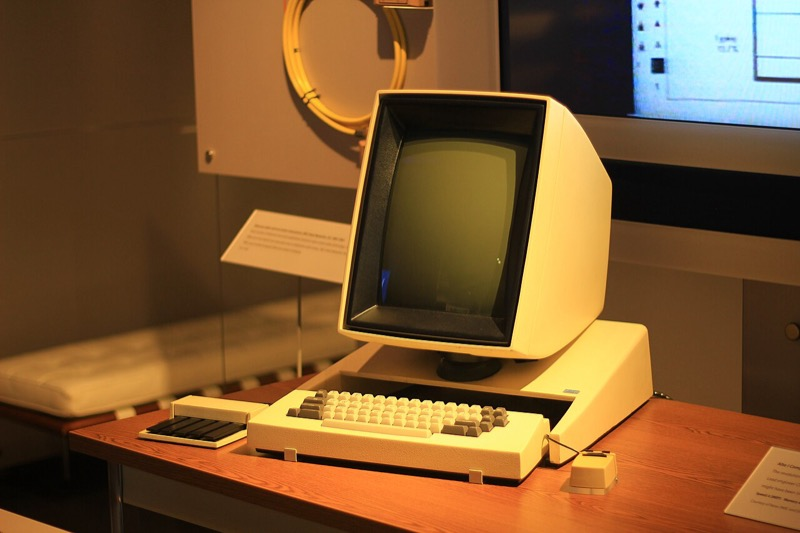

*Xerox Alto with a three-button mouse and, on the left, a chord keyboard. Photo:
[Michael Hicks](https://commons.wikimedia.org/wiki/File:Xerox_Alto_with_mouse_and_chorded_keyset_-_Computer_History_Museum.jpg),
[CC BY 2.0](https://creativecommons.org/licenses/by/2.0), resized.*

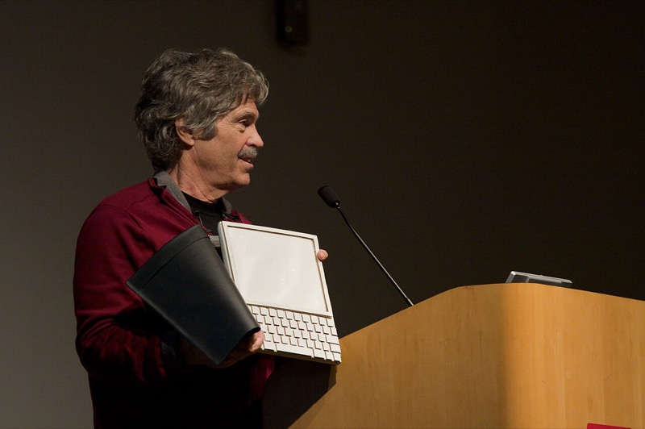

*Alan Kay with the Dynabook model, 2008. Photo:
[Marcin Wichary](https://commons.wikimedia.org/wiki/File:Alan_Kay_and_the_prototype_of_Dynabook,_pt._5_(3010032738).jpg),
[CC BY 2.0](https://creativecommons.org/licenses/by/2.0), resized.*

Smalltalk was the first system with overlapping windows and pop-up menus. Steve Jobs saw it at PARC
in December 1979. Goldberg refused to show it to him, but her managers made her do it. Apple later
sold the Lisa and the Macintosh, both with windows and a mouse. Most people first read about
Smalltalk in the August 1981 issue of *Byte*. Kay also invented the term "object-oriented".
Python, Ruby and Java were influenced by Smalltalk.

We use Smalltalk because all of its code can be read and changed. The windows and menus are written
in Smalltalk too, and you can change them while the system is running.

To look at: [*Byte*, August 1981](https://archive.org/details/byte-magazine-1981-08) ·
[Alan Kay, "The Early History of Smalltalk"](https://worrydream.com/EarlyHistoryOfSmalltalk/) ·
[scanned Smalltalk textbooks](http://stephane.ducasse.free.fr/FreeBooks.html) ·
[Smalltalk on the Alto](https://commons.wikimedia.org/wiki/File:Alto-smalltalk.png) ·
[the Smalltalk balloon](https://commons.wikimedia.org/wiki/File:Smalltalk_Balloon.svg)

| | Mac | Windows |
|---|---|---|
| Paste | Cmd V | Ctrl V |
| Select all | Cmd A | Ctrl A |
| **Run** ("do it") | **Cmd D** | **Ctrl D** |
| Print the answer | Cmd P | Ctrl P |
| **Stop** | **right-click** | **right-click** |

## 1. Try toothpaste

Open a workspace: hold the mouse on the grey, move to **open…**, let go. Then click **open workspace**.

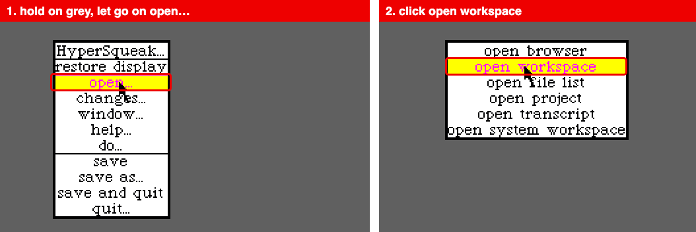

Click in the yellow window and type:

```smalltalk
Display newDepth: 1.
Form toothpaste: 30.
[Sensor anyButtonPressed] whileTrue
```

| Line | Meaning |
|---|---|
| `Display newDepth: 1` | black and white screen |
| `Form toothpaste: 30` | start toothpaste, 30 pixels thick |
| `[Sensor anyButtonPressed] whileTrue` | wait until the mouse button is released |

Press **Cmd A** to select all, then **Cmd D** to run (Windows: **Ctrl A**, **Ctrl D**).
Or hold the right mouse button in the window and let go on **do it**.

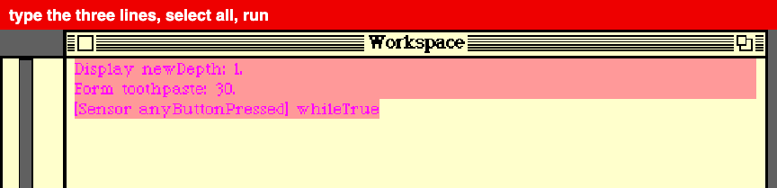

Drag on the grey to draw. Right-click to stop.

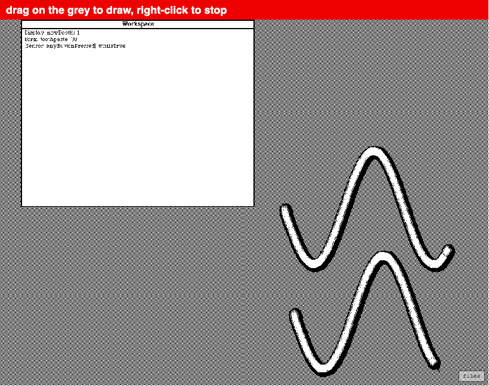

Reload the page to get colour again.

## 2. Open a workspace

Hold the mouse on the grey, move to **open…**, let go. Then click **open workspace**.


## 3. Paste the code

Copy this. Click in the yellow window. Paste. If Chrome asks, allow it.

```smalltalk
"TOOTHPASTE"
| size colors ball n shine brush trail mouse point |
size _ 30.                         "how thick"
colors _ Color red wheel: 20.      "20 colours, starting at red"
ball _ Form dotOfSize: size.       "the ball"
n _ 1.                             "which line we are on"
shine _ Form extent: size@size offset: (size // -2) asPoint.
#(5 1 2 3) with: #(veryLightGray black gray lightGray) do: [:i :grey |
	(Form dotOfSize: i * size // 5) displayOn: shine   "4 grey dots"
		at: (size * (i = 5 ifTrue: [5] ifFalse: [4]) // 10) asPoint
		clippingBox: shine boundingBox
		rule: Form under fillColor: (Color perform: grey)].
[Sensor waitButton. Sensor yellowButtonPressed] whileFalse: [
	brush _ BitBlt toForm: Display.                    "a new line"
	brush colorMap: (Bitmap with: 0 with: 16rFFFFFFFF).
	mouse _ Sensor cursorPoint.
	trail _ OrderedCollection new.
	16 timesRepeat: [trail addLast: -50 @ -50].
	[trail isEmpty] whileFalse: [
		mouse _ mouse * 4 + Sensor cursorPoint // 5.    "follow the mouse"
		point _ Sensor redButtonPressed ifTrue: [mouse] ifFalse: [-50 @ -50].
		brush copyForm: ball to: point rule: Form paint   "draw the ball"
			fillColor: (colors atWrap: n * 9).
		brush copyForm: shine to: trail removeFirst rule: Form erase.   "shine"
		Sensor redButtonPressed ifTrue: [trail addLast: point]].
	n _ n + 1]. [Sensor anyButtonPressed] whileTrue
```

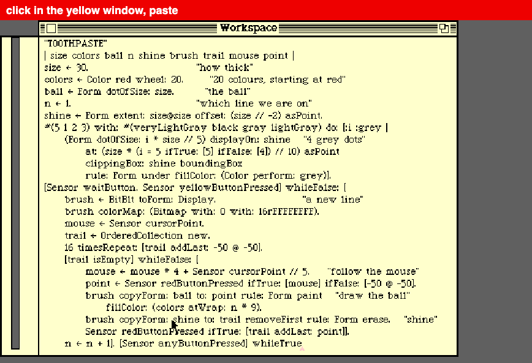

## 4. Run it

Press **Cmd A** to select all, then **Cmd D** to run (Windows: **Ctrl A**, **Ctrl D**).
Drag on the grey to draw. Right-click to stop.

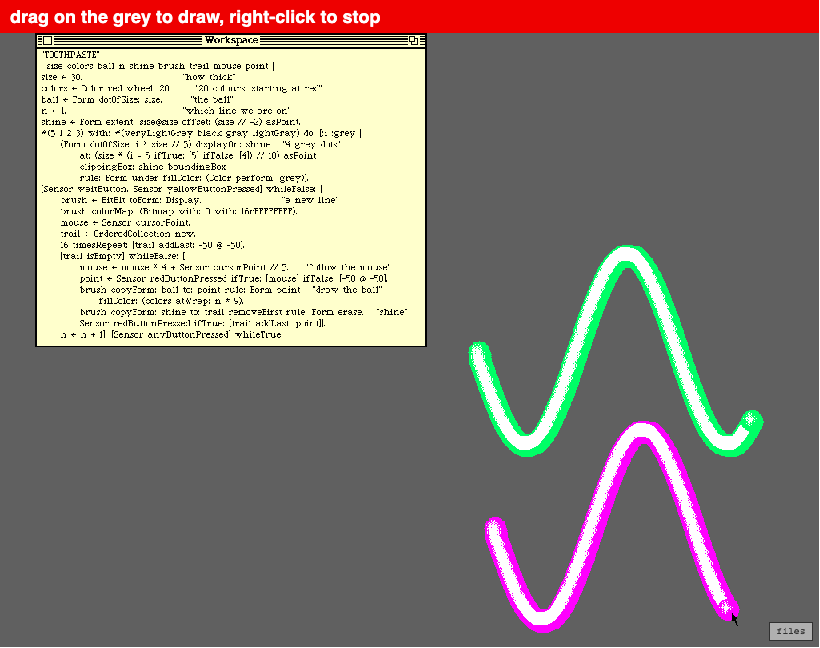

## 5. Change it

Drag over a number and type a new one. Press **Cmd A**, then **Cmd D** (Windows: **Ctrl A**, **Ctrl D**).

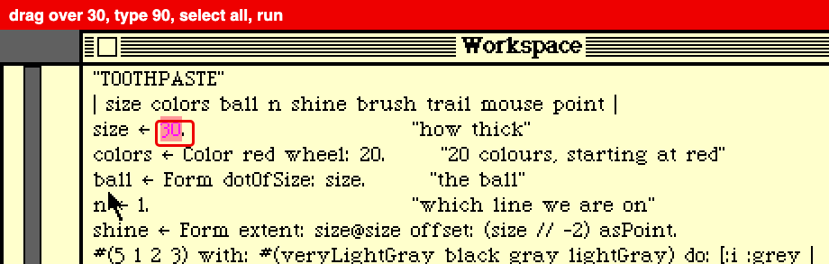

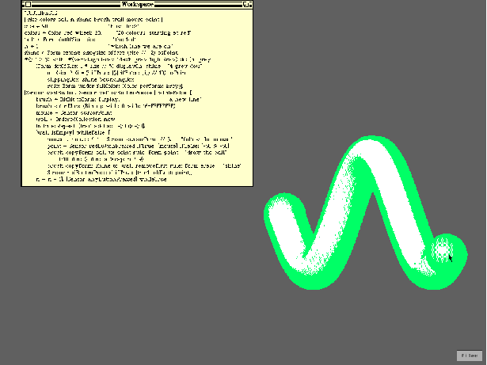

| Change | Try |
|---|---|
| `size _ 30` | `8`, `90` |
| `Color red wheel: 20` | `Color blue wheel: 3` |
| `n * 9` | `n` |
| `mouse * 4 + Sensor cursorPoint // 5` | `mouse * 19 + Sensor cursorPoint // 20` |
| `rule: Form paint` | `rule: Form reverse` |

### Other shapes

Replace `ball _ Form dotOfSize: size.` with one of these:

| Shape | Code |
|---|---|
| Square | `ball _ Form extent: 30@30. ball fillBlack.` |
| Thin bar | `ball _ Form extent: 4@60. ball fillBlack.` |
| Cursor | `ball _ Cursor wait magnify: (0@0 extent: 16@16) by: 4@4.` |
| Word | `ball _ 'hello' asDisplayText form.` |
| Letter | `ball _ (TextStyle default fontAt: 1) characterFormAt: $A. ball _ ball magnify: ball boundingBox by: 4@4.` |
| Star | `ball _ Form extent: 60@60. (Pen newOnForm: ball) place: 30@55; spiral: 50 angle: 144.` |

Change more:

| Change | Code |
|---|---|
| Put the shape under the mouse pointer | add `ball offset: (0@0) - (ball extent // 2).` after the new line |
| No shine, and a pause between shapes | replace `brush copyForm: shine to: trail removeFirst rule: Form erase.` with `trail removeFirst. (Delay forMilliseconds: 300) wait.` |
| More space between shapes | replace `mouse _ mouse * 4 + Sensor cursorPoint // 5.` with `mouse _ Sensor cursorPoint.` |
| Other cursors | replace `wait` with `normal`, `read`, `write`, `execute`, `crossHair`, `menu` or `move` |

To find more, run one of these lines. A code browser is opened with the list on the right:

| List | Code |
|---|---|
| Ways to make a Form | `BrowserView browseFullForClass: Form class method: #dotOfSize:` |
| Cursors | `BrowserView browseFullForClass: Cursor class method: #wait` |

## Basic syntax

Write the name of an object, then a message to that object. Paste this, click on a line and press
**Cmd P** (Windows: **Ctrl P**). The answer is printed underneath.

```smalltalk
3 + 4                   "send + 4 to the number 3: 7"

2 + 3 * 4               "always left to right: 20"

2 + (3 * 4)             "round brackets go first: 14"

'hello' size            "text goes in single quotes: 5"

3 max: 9                "write a value after the colon: 9"

50 atRandom             "a random number from 1 to 50"

(1 to: 5) collect: [:i | i * i]     "square brackets: code for later"
```

A variable and a choice. Select all, then Cmd P:

```smalltalk
| x |                   "make a variable"
x _ 5.                  "put 5 in it. end with a full stop"
x > 3 ifTrue: ['big'] ifFalse: ['small']
```

| | |
|---|---|
| `"text"` | a comment, for people reading the code |
| `'text'` | text |
| `_` | put a value into a variable (shown as an arrow in Squeak) |
| `.` | end of a statement |
| `;` | another message to the same object: `pen go: 100; turn: 90` |
| `750 @ 400` | a point on the screen, x and y |

## Objects

Names with a capital letter are objects that come with Squeak.

| Object | What it is | Examples |
|---|---|---|
| `Display` | the whole screen, windows included | `Display width` the width of the screen in pixels |
| `Sensor` | the mouse (and the keyboard) | `Sensor cursorPoint` where the mouse is<br>`Sensor redButtonPressed` true while the left button is pressed<br>`Sensor yellowButtonPressed` true while the right button is pressed<br>`Sensor waitButton` wait for a click |
| `Form` | a picture made of pixels | `Form dotOfSize: 30` a round dot<br>`Form fromDisplay: ...` a copy of a piece of the screen |
| `Color` | a colour | `Color red`, `Color blue`, `Color random`<br>`Color red wheel: 20` a list of 20 colours |
| `Pen` | a pen for drawing lines | `pen place: 750 @ 400` move the pen to a point without drawing<br>`pen go: 100` draw a line 100 pixels long<br>`pen turn: 90` turn the pen 90 degrees<br>`pen goto: ...` draw a line to a point<br>`pen defaultNib: 3` line width |
| `BitBlt` | a fast way to copy pixels, used in toothpaste (pronounced "bit blit") | `brush copyForm: ball to: point ...` |
| `OrderedCollection` | a list | `trail addLast: x` add to the end<br>`trail removeFirst` take from the front |
| `Delay` | a pause | `(Delay forMilliseconds: 50) wait` |

Names with a small letter (`ball`, `size`, `trail`) are variables. They are listed between two bars
at the top of the program: `| ball size trail |`.

These are the drawing instructions, part by part:

```smalltalk
ball displayOn: Display                  "draw the ball on the screen"
	at: Sensor cursorPoint               "where the mouse is"
	clippingBox: Display boundingBox     "stay inside the screen"
	rule: Form paint                     "cover what is already there"
	fillColor: Color red                 "in this colour"
```

With `Form paint` the new colour covers the old one. With `Form reverse` and `Form under` the two
colours are mixed. Some mixes are invisible, for example red on grey.

Loops and choices:

| Code | Meaning |
|---|---|
| `36 timesRepeat: [ ... ]` | do it 36 times |
| `1 to: 100 do: [:i \| ... ]` | do it 100 times, with `i` = 1, 2, 3 ... |
| `[ ... ] whileFalse: [ ... ]` | repeat until the first part is true |
| `... ifTrue: [ ... ] ifFalse: [ ... ]` | if yes, do this. if no, do that |

## Clean the screen

Hold on the grey, move to **restore display**, let go. Don't let go on **quit**.

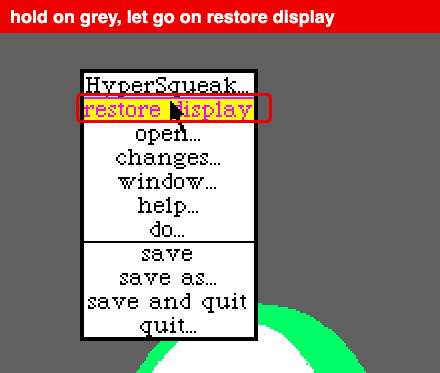

## If it breaks

- **You see new text inside your code:** there is a mistake at that place. Select all and paste the code again.
- **You see a menu or a new window:** choose **cancel**, or click the small box at the top left of the window.
- **Nothing works:** reload the page and paste again.
- Don't use the arrow keys. In Squeak 1.1 they add invisible characters to your code.

## More programs

Select all and paste a new program over the old one. Select all again and run it.

### Simple brush

```smalltalk
"SIMPLE BRUSH"
| ball |
ball _ Form dotOfSize: 30.                       "size"

[Sensor yellowButtonPressed] whileFalse: [       "until right-click"
	Sensor redButtonPressed ifTrue: [            "while you drag"
		ball displayOn: Display
			at: Sensor cursorPoint               "where"
			clippingBox: Display boundingBox
			rule: Form paint
			fillColor: Color red]].               "colour"
[Sensor anyButtonPressed] whileTrue
```

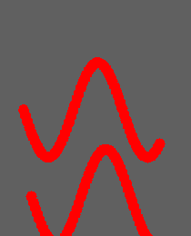

### Confetti

```smalltalk
"CONFETTI"
| ball spot |
[Sensor yellowButtonPressed] whileFalse: [
	Sensor redButtonPressed ifTrue: [
		ball _ Form dotOfSize: 20 atRandom.      "random size, 1 to 20"
		spot _ (100 atRandom - 50) @ (100 atRandom - 50).   "spread"
		ball displayOn: Display
			at: Sensor cursorPoint + spot
			clippingBox: Display boundingBox
			rule: Form paint
			fillColor: Color random]].            "random colour"
[Sensor anyButtonPressed] whileTrue
```

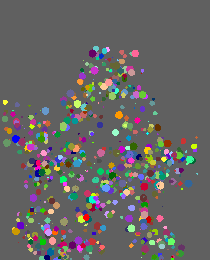

### Mirror

```smalltalk
"MIRROR"
| ball mouse |
ball _ Form dotOfSize: 20.
[Sensor yellowButtonPressed] whileFalse: [
	Sensor redButtonPressed ifTrue: [
		mouse _ Sensor cursorPoint.

		"your line"
		ball displayOn: Display at: mouse
			clippingBox: Display boundingBox
			rule: Form paint fillColor: Color blue.

		"the mirrored line"
		ball displayOn: Display at: (Display width - mouse x) @ mouse y
			clippingBox: Display boundingBox
			rule: Form paint fillColor: Color red]].
[Sensor anyButtonPressed] whileTrue
```

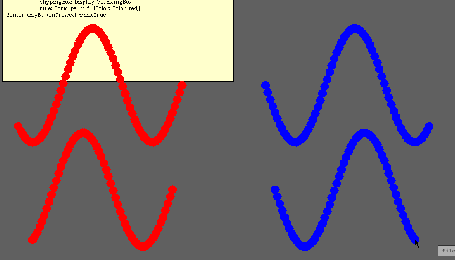

### Words

```smalltalk
"WORDS"
[Sensor yellowButtonPressed] whileFalse: [
	Sensor redButtonPressed ifTrue: [
		'computer room' displayAt: Sensor cursorPoint.   "your text"
		(Delay forMilliseconds: 50) wait]].               "pause between words"
[Sensor anyButtonPressed] whileTrue
```

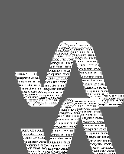

### Late brush

```smalltalk
"LATE BRUSH: the line is drawn one second later"
| ball trail |
ball _ Form dotOfSize: 20.
trail _ OrderedCollection new.
[Sensor yellowButtonPressed] whileFalse: [

	"remember where the mouse is"
	Sensor redButtonPressed
		ifTrue: [trail addLast: Sensor cursorPoint]
		ifFalse: [trail addLast: -50 @ -50].

	"draw where it was 100 steps ago"
	trail size > 100 ifTrue: [
		ball displayOn: Display at: trail removeFirst
			clippingBox: Display boundingBox
			rule: Form paint fillColor: Color green].

	(Delay forMilliseconds: 10) wait].
[Sensor anyButtonPressed] whileTrue
```

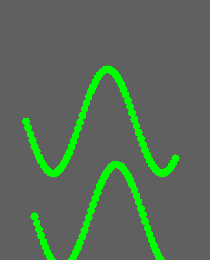

### Smear

```smalltalk
"SMEAR: smear the screen, windows too"
| corner piece |
[Sensor yellowButtonPressed] whileFalse: [
	Sensor redButtonPressed ifTrue: [
		corner _ Sensor cursorPoint - 40.
		piece _ Form fromDisplay: (corner extent: 80 @ 80).  "copy a square"
		piece displayAt: corner + (4 @ 4).           "put it back, moved"
		(Delay forMilliseconds: 20) wait]].
[Sensor anyButtonPressed] whileTrue
```

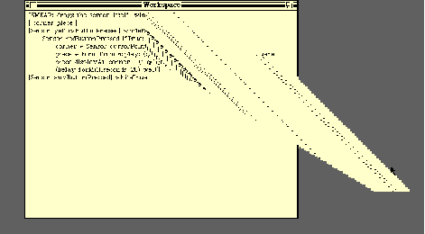

### Web

```smalltalk
"WEB: lines from one point to your mouse"
| pen |
pen _ Pen new.
pen defaultNib: 1.                        "line width"
[Sensor yellowButtonPressed] whileFalse: [
	Sensor redButtonPressed ifTrue: [
		pen color: Color random.          "colour"
		pen place: 750 @ 400.             "start here"
		pen goto: Sensor cursorPoint.     "draw to the mouse"
		(Delay forMilliseconds: 20) wait]].
[Sensor anyButtonPressed] whileTrue
```

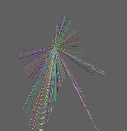

### Star

```smalltalk
"STAR: no mouse needed"
| pen |
pen _ Pen new.
pen defaultNib: 3.              "line width"
pen color: Color magenta.       "colour"
pen place: 750 @ 450.           "where to start"
36 timesRepeat: [               "how many lines"
	pen go: 250.                "how long"
	pen turn: 170]              "how far to turn, in degrees"
```

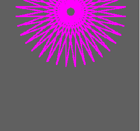

### Spiral

```smalltalk
"SPIRAL: no mouse needed"
| pen |
pen _ Pen new.
pen defaultNib: 2.
pen place: 750 @ 400.
1 to: 100 do: [:i |             "repeat with i = 1, 2, 3 ... 100"
	pen color: Color random.
	pen go: i * 4.              "make each line a bit longer"
	pen turn: 89]               "try 90, 121, 144"
```

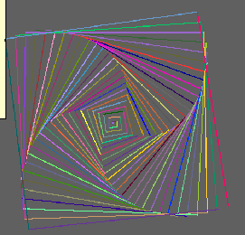

## Write your own

Mix two of these, or make a brush that is hard to use.

## Hand it in

Select all, copy (Cmd C / Ctrl C), and post your code to are.na with a screenshot.

## About

Squeak 1.1 (1996), a direct descendant of Smalltalk-80 from Xerox PARC, running in
[SqueakJS](https://squeak.js.org). The original program is inside it: run
`Form toothpaste: 30. [Sensor anyButtonPressed] whileTrue`.
Code of the room: [dewalt-1/smalltalk-room](https://github.com/dewalt-1/smalltalk-room).
